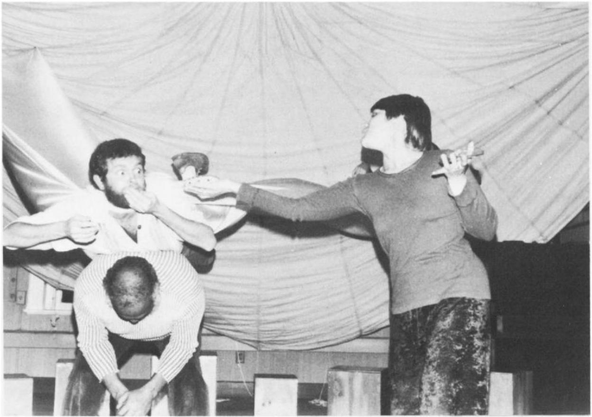
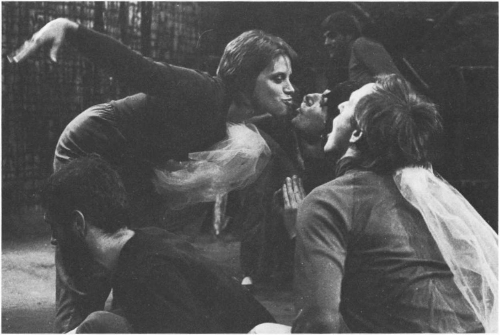
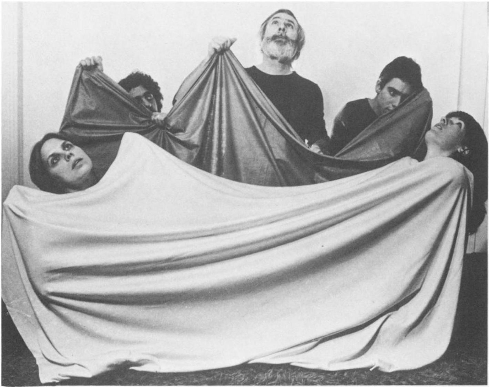

# Culture and Community: Playback Theatre 文化与社群：一人一故事剧场

by Jo Salas

作者：乔·萨拉斯

Playback Theatre is a company based in the Mid-Hudson Valley. There are 11 people in the company, six of them founding members. Five people are salaried. The entire group meets weekly and for performances.

一人一故事剧场是一家位于中哈德逊河谷的剧团。剧团共有11名成员，其中6人为创始成员。有5名成员领取薪水。整个剧团每周都会聚在一起，并为演出进行排练。

Since 1975 Playback Theatre has been teaching and performing a form of improvisation devised by its director, Jonathan Fox. In this form, the dramas of real lives, related by volunteers from the audience, become theatre pieces created on the spot by the actors. Someone once described it as “theatre of the cave,” referring to theatre’s origin in the ancient impulse to communicate and dramatize one’s experience, thereby integrating it both in one’s psyche and in the evolution of the community.

自1975年以来，一人一故事剧场一直致力于教授并演绎一种由其导演乔纳森·福克斯创立的即兴表演形式。在此形式中，由观众讲述的真实生活故事，会被演员们当场改编成戏剧作品。有人曾将其描述为“洞穴剧场”，以此指涉戏剧起源于人类古代那种交流并戏剧化自身经历的冲动，从而将这种经历既融入个体的心理，也融入社群的演进之中。

For this kind of personal storytelling to work in the modern context of an audience who begins the evening as strangers-accustomed to privacy and expecting to sit back and be entertained-it is essential to create an atmosphere of safety and respect. The actors, on stage throughout the performance, are receptive to the unknown roles they will be asked to play, and come back to their own personalities between scenes. There is an element of humility: They are there to reflect and fulfill the audience’s stories. Seeing the actors’ demeanor, audience members feel safe enough to respond when they are invited to talk about something that has happened to them-a happy or painful memory, a dream, a fantasy. The “Teller,” guided by the director, or “Conductor,” casts his or her story from the row of actors. The chosen performers, supported by music and lighting, transform the story into a theatrical scene, using boxes and pieces of cloth as props. Story follows story as a collective drama is built, reflecting the lives of the people present.

要在现代语境下让这种个人叙事发挥作用——观众在演出开始时互为陌生人，习惯于隐私，并期待着坐下来享受娱乐——营造一种安全且相互尊重的氛围至关重要。演员们在整个演出过程中始终身处舞台，他们乐于接受将被要求扮演的未知角色，并在场景间隙回归自己的本人。其中蕴含着一种谦逊：他们存在的意义在于映射并呈现观众的故事。看到演员们的举止，观众们便感到足够安全，当被邀请谈论自己经历过的事情——无论是快乐还是痛苦的回忆、一个梦想，还是某种幻想——时，他们便能坦然回应。在导演（即“领航员”）的引导下，“讲述者”从演员行列中挑选出适合演绎其故事的人选。被选中的演员在音乐和灯光的衬托下，利用纸箱和彩布作为装置，将故事转化为戏剧场景。一个又一个故事接连展开，共同构建起一部集体戏剧，映照出在场观众的生活。

At a performance last year in New Paltz, New York, the hometown of several company members, a woman named Paula talked about her fear of driving in snowstorms. She had come to several previous performances, but this was her first time as a Teller. She chose an actor to play herself and two more to become the snow. Other actors became customers in her Main Street store, where the scene began. At the climax of the scene, the actors playing the snow threatened and taunted the onstage Paula as she drove homeward trembling. Paula, watching, laughed in recognition. After the scene was over, the Conductor asked her if she wanted to see a transformation-a repeat of the scene with a new ending. Paula wanted to see herself triumph over her fear; the actors created this for her.

去年在纽约新帕尔茨（该剧团几位成员的故乡）的一场演出中，一位名叫宝拉的女士谈到了她对暴风雪中驾车的恐惧。她此前曾观看过几次演出，但这是她第一次担任讲述者。她选了一位演员扮演自己，另选了两位演员扮演雪。其他演员则化身为她位于主街店铺里的顾客——场景正是从那里开始的。在场景的高潮部分，扮演雪的演员们威胁并嘲弄着台上瑟瑟发抖、正开车回家的保拉。保拉看着这一幕，会心一笑。场景结束后，领航员问她是否想看一场转化——即重演该场景但以新的结局收尾。保拉希望看到自己战胜恐惧；演员们便为她实现了这一愿望。

Some weeks later I was in her store. It was the first time I had seen her since the performance. She told me with great pleasure and pride that watching that scene had lessened her fear of driving in snow. She was able to turn the portion that remained into anger and a determination to master the situation. The transformation of her snow panic had also had a similar effect on other fears in her life. Other audience members had told her that they, too, were afraid of driving in bad weather and that they remembered this scene at those frightening moments. The experience of telling her story in public in her own town had deepened her sense of the town as a community.

几周后，我去了她的店里。那是自演出以来我第一次见到她。她满怀喜悦与自豪地告诉我，观看那场戏减轻了她对雪天驾驶的恐惧。她能够将残存的恐惧转化为愤怒，并下定决心掌控局面。她对雪的恐慌的转化，也对她生活中其他恐惧产生了类似的影响。其他观众也告诉她，他们同样害怕在恶劣天气下开车，并在那些令人恐惧的时刻想起了这一幕。在自己所在的小镇上公开讲述自己的故事，加深了她对小镇作为社群的归属感。

Each country, each culture has a profound need for art that is about its own ways of life, incorporating its own sounds, images, symbols and legends. Cultures feel legitimacy, validity and pride when they see their reflections in their art.

每个国家、每种文化都深切需要能够体现自身生活方式、融入自身声音、图像、符号和传说的艺术。当文化在艺术中看到自身的映照时，便会感受到合法性、真实性与自豪感。

When several members of Playback were in Australia in 1980, we met a man who had been part of a team that traveled through parts of the outback, spending a few days in small settlements, becoming familiar enough with each one to write a few songs or a play about that community. Then they would move on, leaving the song or play with the people. It was apparent from the man’s words and from the slides he showed how momentous this was for the communities they visited. Perhaps the sense of validation created in this way would encourage the villagers to write their own plays.

1980年，一人一故事剧团的几位成员在澳大利亚时，曾遇到一位男士。他曾是某支巡演团队的一员，该团队走遍内陆部分地区，在各个小聚居地停留数日，与当地人建立起足够深厚的联系，从而能为每个社群创作几首歌曲或一部戏剧。随后他们便继续前行，将歌曲或剧本留给当地居民。从这位男士的讲述和他展示的幻灯片中，可以明显看出这对他们所访问的社群而言是多么意义重大。也许这种方式所带来的认同感，会鼓励村民们创作自己的剧本。

Members of Playback Theatre improvise a story about flying while dreaming.

一人一故事剧场的成员们即兴演绎了一个关于在梦中飞行的故事。

On a tour of Australia, actors devise a scene about kookaburras.

在澳大利亚巡演期间，演员们创作了一个关于笑翠鸟的场景。

One of Playback Theatre’s main roles is to offer our own community the chance to recognize itself as an entity. Traditional storytelling had this function. The experience of the group, clan or village was heard, crafted, distilled, recorded and told to those to whom it meant the most. The storyteller could be a shaman, a purveyor of magic and truth, vital to the health of the group. When accepted in this role by a community, Playback Theatre embodies these functions and qualities.

一人一故事剧场的主要作用之一，是让我们的社群有机会将自身视为一个整体。传统讲故事的方式曾具备这一功能。群体、氏族或村庄的经历会被倾听、提炼、浓缩、记录，并讲述给那些最受其影响的人。讲故事的人可能是萨满，是魔法与真理的传播者，对群体的健康至关重要。当一人一故事剧场被社群接纳并承担起这一角色时，它便体现了这些功能与特质。

After seven years in the same area-Poughkeepsie and New Paltz-there appears to be some degree of acceptance. It shows in different ways: One is the large number of familiar faces, our “constituency,” who reappear regularly at performances, some of whom seek further involvement by joining classes and workshops. Another sign is the diversity of community agencies and organizations who ask us to work with them or perform for them. Playback Theatre is remembered when the need arises for entertainment, for the airing of problems or for celebration.

在波基普西和新帕尔茨这一地区扎根七年后，我们似乎已获得了一定程度的认可。这种认可以多种方式体现：其一是大量熟悉的面孔——我们的“支持者群体”——会定期出现在演出现场，其中一些人甚至通过参加课程和工作坊来进一步参与其中。另一个迹象是，越来越多的社群机构和组织邀请我们与他们合作或为他们演出。每当需要娱乐、倾诉问题或举办庆祝活动时，人们都会想起一人一故事剧场。

The cornerstones of a Playback performance are common to all lives: pride, chagrin, triumph, loss, expansiveness, fear, humiliation, delight; these exist within the contexts of family and societal relationships, work and the larger world. People are eager to tell and hear life-stories, although both the stories and the audience’s reception tend to fall short of the levels of intimacy, electricity, and revelation that are often part of a performance for an established group (for instance, a conference, a congregation, a class). There is no audience that does not share, however, the desire to tell stories, as well as the excitement and fear associated with doing so. In the hundreds of performances given by Playback over the past seven years, there have always been Tellers.

一人一故事剧场演出的基石是所有人生共有的：自豪、懊恼、胜利、失去、胸怀、恐惧、屈辱、喜悦；这些情感存在于家庭和社会关系、工作以及更广阔的世界之中。人们热切地想要讲述和聆听生活故事，尽管这些故事以及观众的反应往往难以达到固定群体（例如会议、聚会、课堂）表演中常见的亲密感、激情和启示的程度。然而，没有哪一群观众不曾怀有讲述故事的渴望，以及随之而来的兴奋与恐惧。在过去七年中，一人一故事剧场举办的数百场演出中，始终都有讲述者的身影。

The actors use large pieces of colored cloth as sets and props.

演员们使用大块彩色彩布作为布景和装置

In a Playback Theatre performance, there are prescribed rituals and forms, readily understood by new audience members and providing continuity to those who have come before. The performances are always set up in the same way: the Conductor on the stage right (left from the audience's view), seated beside the empty Teller’s chair; the musician on the left with an array of instruments spread out on the floor; between them a semi-circle of actors sitting on boxes; and upstage at left a wooden structure hung with many colored pieces of cloth, to be used as props. The words used by the Conductor are formulas for creating specific effects. The actors’ procedure in preparing for and concluding a scene is always the same. Along with the ritual elements, these techniques provide an atmosphere of respect, familiarity and safety in which both audience and actors are invited to be adventurous, spontaneous and creative.

在一人一故事剧场的演出中，存在着既定的仪式和形式，新观众能轻易理解，同时也为老观众提供了延续感。演出布景始终如一：指挥位于舞台右侧（从观众视角看为左侧），坐在空置的讲述者座椅旁；乐师在左侧，各种乐器散落在地板上；两人之间，演员们坐在箱子上围成半圆；舞台左后方则有一座悬挂着许多彩色彩布片的木制结构，用作装置。领航员使用的词句是用来营造特定效果的固定话术。演员们在准备和结束场景时的流程始终如一。这些技巧与仪式元素相结合，营造出一种充满尊重、熟悉与安全感的氛围，邀请观众和演员共同体验冒险、自发与创造的乐趣。

The stories are fragments of lives, often chaotic, half-understood by the Teller, without clear beginnings, endings or climaxes. This is the nature of ongoing experience. It is difficult to describe and contain real events without remaining on the anecdotal level. It is the task of the Conductor, the actors, the musician and the lighting person to receive raw material, filter it through their understanding and inspiration, condense certain aspects of it, expand others-all without discussion-and present Teller and audience with a theatre piece. The Teller has an opportunity to comment on and correct the scene, if necessary. In stories with an unhappy outcome, the Teller may be invited to find a new ending, after seeing it once.

这些故事是生活的片段，往往杂乱无章，连讲述者自己也只理解了一半，没有明确的开头、结尾或高潮。这就是持续体验的本质。若不局限于轶事层面，就很难描述和概括真实的事件。领航员、演员、乐师和灯光师的任务，就是接收这些原始素材，通过他们的理解与灵感进行过滤，浓缩其中的某些方面，扩展其他方面——所有这些都不需要事先讨论——并向讲述者和观众呈现一部戏剧作品。讲述者有机会对场景进行评论，并在必要时进行修正。对于结局不圆满的故事，讲述者可能在观看一次后，被邀请为故事寻找一个新的结局。

This process allows the Teller and other audience members to see their experience crystallized, made clear and cohesive. In scenes where a transformation is appropriate, the Teller has a chance to be the refiner, to craft the raw material of life. A series of moments from the confusion of ordinary life becomes the subject for intense artistic focus and expression; the moments are comprehended, celebrated and entrusted to the community’s reservoir of self-knowledge.

这一过程让讲述者和其他观众得以见证自身经历的凝练、澄清与整合。在适合进行转化的场景中，讲述者有机会成为提炼者，对生活的原始素材进行雕琢。日常生活中那些纷乱的瞬间，由此成为艺术深度聚焦与表达的主题；这些瞬间被理解、被颂扬，并被托付给社群的自我认知宝库。

At one performance in Albany the first story told was a father’s about trouble between his two teenage sons and how he was able to help by listening and talking to one of them. The last story of the evening was told by an elderly woman who was reluctant to leave her seat in the audience to come onstage. Her story was about the peaceful death of her husband: at home, surrounded by loving family, despite choruses of criticism and unwelcome advice from friends who thought he should have been hospitalized. There was a small group of elderly people in the front row. They did not participate by telling stories, but I saw a look of wonder and excitement on their faces as they realized that they were invited to be creators, to share in the act of theatre. Everywhere Playback Theatre has performed, it has encountered this eagerness for the public and ritualized communication of personal experience. Theatre may have other functions but none more fundamental.

在奥尔巴尼的一次演出中，第一个故事来自一位父亲，讲述了他两个十几岁儿子之间的矛盾，以及他是如何通过倾听并与其中一个儿子交谈来帮助解决问题的。当晚的最后一个故事由一位年长女士讲述，她起初不愿离开观众席走上舞台。她的故事讲述了丈夫安详离世的经过：在家中，在亲人的环绕下，尽管朋友们纷纷批评并提出不请自来的建议，认为他本应住院治疗。前排坐着一小群老人。他们虽然没有参与讲故事，但我看到当他们意识到自己被邀请成为创作者、参与戏剧表演时，脸上流露出的惊奇与兴奋神情。无论一人一故事剧场在何处演出，都会遇到这种渴望——渴望公众参与，渴望将个人经历以仪式化的方式进行交流。戏剧或许还有其他功能，但没有比这更根本的了。